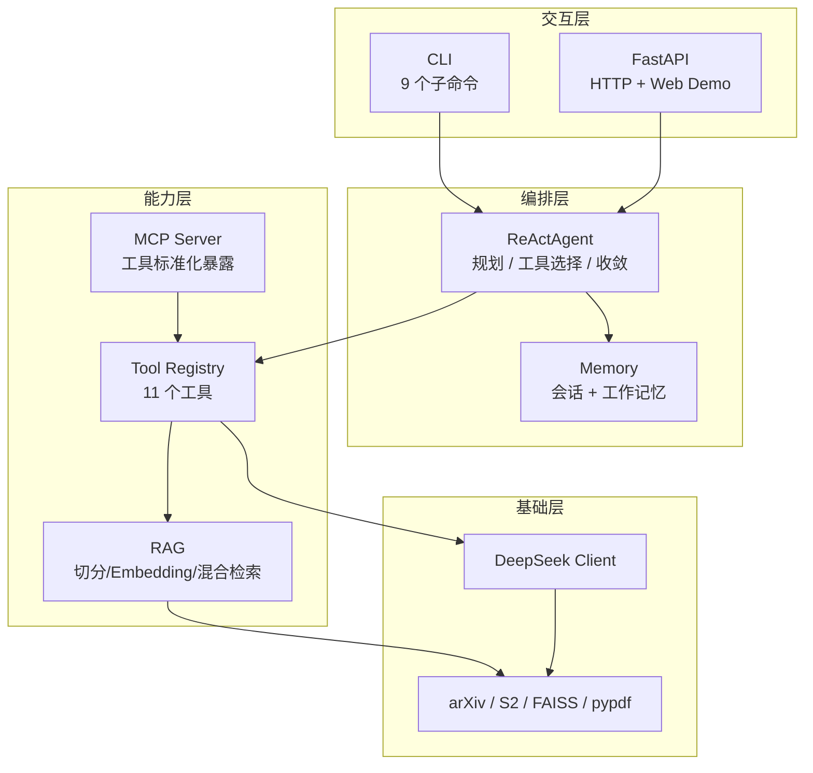
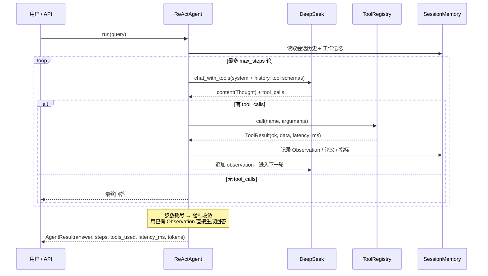

# ResearchAgent

> 基于 **ReAct + RAG + MCP** 的科研智能分析 Agent —— 检索论文、解析 PDF、抽取实验指标、对比分析，并给出**带原文引用**的分析报告。

[](https://www.python.org/)
[](https://fastapi.tiangolo.com/)
[](https://modelcontextprotocol.io/)
[](tests/)
[](LICENSE)

---

## 目录

- [一、我做了什么](#一我做了什么)
- [二、为什么这么做](#二为什么这么做)
- [三、架构设计思路](#三架构设计思路)
- [四、跑起来（能编译运行）](#四跑起来能编译运行)
- [五、使用示例](#五使用示例)
- [六、工具清单](#六工具清单)
- [七、项目结构](#七项目结构)
- [八、评测结果](#八评测结果)
- [九、已知不足](#九已知不足)

---

## 一、我做了什么

一个**能跑起来**的科研分析 Agent，不是一个只能读的 demo。输入一句「找几篇 RAG 的论文，把它们的实验指标抽出来做个对比」，它自己规划步骤、调工具、读 PDF、抽数字、出对比结论——而且**每一步推理都可见、每个结论都有出处**。

### 交付物

| 交付物 | 位置 | 规模 / 说明 |
| --- | --- | --- |
| 核心系统 | `research_agent/` | 9 个子包、38 个模块、约 5,000 行 |
| CLI | [`cli.py`](research_agent/cli.py) | 9 个子命令：`ask` / `chat` / `index` / `search` / `eval` / `tools` / `doctor` / `serve` / `mcp` |
| HTTP API | [`api/`](research_agent/api/) | 6 组端点 + 自动 OpenAPI 文档 |
| Web Demo | [`web/index.html`](web/index.html) | 零构建、单文件、带 ReAct 轨迹展示 |
| MCP Server | [`mcp_server/`](research_agent/mcp_server/) | 11 个工具标准化暴露（`stdio` / `inprocess`） |
| 单元测试 | [`tests/`](tests/) | **68 个用例**、869 行，不依赖网络与 LLM |
| 评测框架 | [`eval/`](research_agent/eval/) | 13 条用例 / 6 类场景 / 四维指标 / 自动报告 |
| 架构文档 | [`docs/architecture.md`](docs/architecture.md) | 分层、时序图、关键决策 |
| 容器化 | [`Dockerfile`](Dockerfile)、[`docker-compose.yml`](docker-compose.yml) | 一条命令起服务 |

### 量化结果（实测，非估算）

| 维度 | 指标 | 结果 |
| --- | --- | --- |
| 任务成功率 | Task Success Rate | **100.0%** (13/13) |
| 工具调用准确率 | Tool Calling F1 | **80.3%**（P 75.8% / R 95.5%） |
| 检索准确率 | Hit Rate / MRR | **100.0%** / **MRR 1.000** |
| 延迟 | mean / p50 / p95 | 43.7s / 35.2s / 107.0s |
| 平均步数 / Token | steps / tokens | 3.69 步 / 13,165 tokens |
| 单元测试 | pytest | **68 用例**（67 通过 + 1 按设计跳过） |

> 延迟被 arXiv 源站封 IP 的等待时间显著抬高，见 [§8 评测结果](#八评测结果) 的说明；纯本地用例（analysis / experiment）延迟仅 **2.3–5.3s**。

---

## 二、为什么这么做

### 2.1 先把问题定义清楚

真实需求长这样：

> 「帮我找几篇 RAG 的论文，把它们的实验指标抽出来做个对比。」

手动做要 1~2 小时：检索 → 下载 → 读 → 抄表格 → 整理。这件事的本质是**多步工具编排 + 非结构化信息提取**，而不是「问一句话答一句话」。所以我要的不是一个聊天框，而是：

1. **能规划**——把模糊需求拆成可执行步骤，走一步看一步；
2. **有据可查**——结论必须能追溯到原文片段，而不是模型编的数字；
3. **可度量**——能证明它好用，也能定位它哪里不好用。

这三点决定了后面所有的技术选型。

### 2.2 六个关键决策

| # | 决策 | 一句话理由 |
| --- | --- | --- |
| 1 | 保留 ReAct 轨迹，但工具调用走**原生 Function Calling** | 格式鲁棒性 > 论文形态的纯粹性 |
| 2 | 检索用**稠密向量 + BM25 + RRF 融合** | 科研语料全是专有名词，纯向量反而弱 |
| 3 | 工具**一次定义、三处复用** | 三份定义必然漂移，不一致是迟早的事 |
| 4 | 评测做**四维指标 + 独立检索探针** | 只看成功率永远定位不到根因 |
| 5 | 对外部依赖**全链路优雅降级，且降级不静默** | 依赖不可控，但「悄悄给差答案」不可接受 |
| 6 | 步数耗尽时**强制收敛**，而不是抛错 | 安全网要在最坏情况下真的兜住 |

#### 决策 1：ReAct 保留三段式轨迹，工具调用交给原生 Function Calling

**选择**：每步照样产出 `Thought / Action / Observation`，但 `Action` 的选取走 DeepSeek 的 `tool_calls`，而不是让模型输出文本再正则解析。

**为什么**：ReAct 论文的原始形态是解析文本，这在生产里很脆——模型少一个换行、用了中文冒号，解析就崩。而 native 调用由 API 侧保证 JSON 合法；`tools` 参数携带 JSON Schema，参数类型由 Schema 约束，而不是靠提示词求模型「请传数组」；失败模式也从「解析失败」变成「参数不匹配」，后者能被工具层捕获并作为 Observation 回传，**Agent 据此可以自我纠正**。

**代价**：依赖模型支持 tool calling，且轨迹需要自己从消息流里重组（见 [`react_agent.py`](research_agent/agent/react_agent.py) 的 `AgentStep`）。

#### 决策 2：检索用稠密向量 + BM25 双路召回，RRF 融合

**为什么不用纯向量**：科研场景全是专有名词和缩写——`SQuAD`、`F1`、`BLEU-4`、`RAFT`。这类词恰恰是向量模型的弱项（训练语料里少见、又被切进子词），而 BM25 的精确匹配在这里反而更强。两者互补，所以都留着。

**为什么融合用 RRF 而不是加权求和**：余弦相似度和 BM25 分数根本不在一个量纲上，加权求和前必须先做分数归一化，而归一化方式本身又是一个要调的超参。RRF 只用**排名**：

```
score(d) = Σ_r  1 / (k + rank_r(d))        # k = 60
```

免掉了归一化这个麻烦，且对不同检索器的分数尺度天然免疫。

**代价**：多一路召回和融合开销；Rerank 目前只做了「查询词重叠 ×1.15」的轻量加权，没上 cross-encoder（见 [§9](#九已知不足)）。

#### 决策 3：工具一次定义、三处复用

同一个 `Tool` 对象同时是**本地可调用函数** + **Function Calling Schema** + **MCP Tool 定义**：

```python
Tool(
    name="search_papers",
    description="检索论文",
    schema={"type": "object", "properties": {...}},   # ← 三处共用的唯一契约
    func=search_papers_impl,
)
```

**为什么**：如果本地实现一套、FC Schema 一套、MCP 定义再一套，那么「改了一处忘另一处」只是时间问题——而 Schema 与实现不一致导致的失败极其隐蔽（模型按旧 Schema 传参，工具静默丢字段）。把 Schema 提成唯一契约，三处都从它派生，不一致在结构上就不可能发生。

这条还顺手解决了一个真问题：把 `list[str]` 这类 PEP 585 泛型正确映射成 JSON Schema 的 `array`（`isinstance(list[str], type)` 在 3.9+ 为真，会先被 `type` 分支吞掉，最终退化成一个 `string`，模型就会把数组传成字符串）。**这个 bug 只有真实端到端调用才暴露，打桩测试永远不会发现。**

#### 决策 4：四维评测，检索指标用独立探针测

只测「任务成功率」是不够的——成功率掉下来的时候你仍然不知道该改哪里。所以拆成四个维度，**并且检索指标绕过 Agent、直接用探针查知识库**：

| 探针结果 | Agent 行为 | 根因 | 该优化什么 |
| --- | --- | --- | --- |
| ❌ 没召回 | — | **检索层**问题 | 切分粒度、Embedding、融合策略 |
| ✅ 召回了 | Agent 没去检索 | **决策层**问题 | Prompt、工具描述、任务规划 |
| ✅ 召回了 | Agent 检索了但答错 | **生成层**问题 | 最终回答的 Prompt 与上下文组织 |

这三类问题的优化手段完全不同。混在一个指标里，就永远只能猜。

> 顺带一提：这个「先分离变量」的思路不只是雕琢指标。它当场救过一次场——报告里的检索准确率一度恒为 `0.0%`，我第一反应是「检索不行」，做了探针之后才发现检索**完全正常**，是度量代码在顶层找 `item["source"]`，而数据实际在 `item["metadata"]["source"]`。**度量写错比检索写错危险得多，因为它会让你去修一个没坏的东西。**

#### 决策 5：全链路优雅降级，且降级不静默

| 依赖 | 首选 | 降级路径 |
| --- | --- | --- |
| 向量索引 | FAISS `IndexFlatIP` | NumPy 精确余弦检索 |
| Embedding | BGE (`sentence-transformers`) | Hashing Embedder |
| 论文检索 | arXiv API | Semantic Scholar → 内置离线论文库 |
| PDF 解析 | pypdf | pypdfium2 |
| 指标抽取 | LLM 抽取 | 正则模板抽取 |

**为什么**：这是真实的外部依赖环境——FAISS 在部分 Python 版本没有 wheel、BGE 模型要联网下载、arXiv 会按 IP 限流、S2 无 Key 时几乎必 429。**任一组件失效，功能减弱但不能中断。**

**但降级绝不能静默**：结果里带 `degraded: true` 与 `sources` 字段，`/health` 状态转为 `degraded`。调用方明确知道「这份数据是降级来的，可信度打折」，而不是拿到一份看起来很正常的差答案。这是我特意加的约束——**最难查的 bug，是那种「不报错但结果是错的」的 bug。**

#### 决策 6：步数耗尽时强制收敛

Agent 到 `max_steps` 上限后，不是把异常抛给用户，而是用已拿到的 Observation 直接生成回答：

> 「基于目前检索到的信息，能确认的是……未能确认的是……原因是……」

**为什么**：这是安全网，而安全网必须在最坏情况下真的兜住。这条路径只在步数耗尽时触发，单步任务永远走不到——所以它长期带着一个必然抛 `TypeError` 的参数冲突 bug 而无人察觉（`got multiple values for keyword argument 'tools'`）。**这正是「降低失败概率」和「保证失败可收敛」必须当成两件事来做的理由。** 现在有专门的回归测试 `test_forced_convergence_works_with_real_llm_client` 盯着它。

### 2.3 最难的一个问题：arXiv 406

论文检索工具间歇性返回 `406 Not Acceptable`。**我最初的判断是错的**：以为是 httpx 把查询里的冒号做了百分号编码，还专门写了个 URL 拼接函数。改完照样 406。

于是做了对照实验：同一时刻用 4 种 User-Agent（含浏览器 UA）请求，**全部 406**；几分钟后**又全部 200**。看起来像随机抖动，我一度就按「WAF 抖动」加了三层重试兜底。

直到把「已知 URL」和「全新 URL」放在一起对比，才看到真相——响应头里：

```
cf-cache-status: MISS, MISS, HIT      age=735
```

**老 URL 命中了 Cloudflare 边缘缓存所以 200，新 URL 回源被 406。** 所谓「过一会儿又好了」，其实是缓存命中，不是解封。

根因是**源站按 IP 限流**，而我的重试每次都在 8 秒内打完 4 次——**重试不带限速，等于变相加重限流**。最终修法是 `_throttle()`：按主机限速（arXiv ≥3s 间隔），先限速再退避重试。

这件事让我记住两句话：**重试不带限速是有害的**；以及遇到「间歇性故障」，**先怀疑自己的观测方式**，再怀疑被观测的系统。

### 2.4 我还修掉了什么

上面这些决策背后，是一次完整的端到端实测——**10 个跨模块 bug 被打桩测试放过，全部靠真实调用才暴露**。挑三个有代表性的：

| 问题 | 表象 | 真实根因 |
| --- | --- | --- |
| LLM 指标抽取 100% 失效 | 静默转正则兜底，无人察觉 | 抽取 Prompt 里 `{` 未转义，`.format()` 必抛 `KeyError`，被 `except` 吞成一行 warning |
| 0 字节 PDF 毒化缓存 | 反复报「Cannot read an empty file」 | 下载时先开文件再收字节，中断即留下 0 字节文件，而它看起来就像一份已缓存的 PDF |
| MCP stdio 工具列表不可用 | 只在 stdio 传输下复现 | mcp 2.x 把 `inputSchema` 改名 `input_schema`；此前只测过 `inprocess` |

**共同点：它们都不报错，只是「结果不对」。** 这也是坚持优雅降级必须显式标记、工具错误必须结构化回传的原因。

---

## 三、架构设计思路

### 3.1 分层：依赖严格单向



| 层 | 代码位置 | 职责 | 依赖方向 |
| --- | --- | --- | --- |
| 交互层 | `cli.py`、`api/` | 参数解析、HTTP 契约 | → 编排层 |
| 编排层 | `agent/`、`memory/` | 规划、工具选择、收敛、上下文 | → 能力层 |
| 能力层 | `rag/`、`tools/`、`mcp_server/` | 检索与工具执行 | → 基础层 |
| 基础层 | `core/` | LLM 客户端、外部 I/O | 无反向依赖 |

**为什么这么切**：`agent/` 完全不知道工具是「本地函数」还是「MCP 远程工具」——它只面对 `ToolRegistry` 这一张表。所以 MCP 是**加进来**的，不是**改进去**的：加 MCP 支持时，Agent 循环一行没动。同理，`rag/` 不知道调用它的是 Agent 还是 HTTP 的 `/search` 端点，评测探针才能绕过 Agent 直接复用同一条检索链路。

### 3.2 一次任务的完整生命周期



### 3.3 三条贯穿全局的原则

**① 单一事实来源（Single Source of Truth）**
最容易漂移的知识，只在一处定义：
- 工具契约 → `Tool` 对象（本地 / FC / MCP 三处派生）
- 检索结果名次 → 由 `retrieve()` 在最终顺序确定后统一赋值（`rank` 是「检索结果的位置」，只有检索器知道；调用方各自推断必然出错——这个 bug 真的发生过，`as_dict()` 漏了 `rank` 而两个调用方都在读它）

**② 失败必须可观测**
- 工具异常 → `ToolResult(ok=False, error=...)` 作为 Observation 回传，Agent 能换策略，而不是整任务崩掉
- 降级 → `degraded: true` + `sources`，`/health` 状态变 `degraded`
- 日志 → 兜底路径用 `exc_info=True` 留堆栈（**「静默兜底」是 bug 的温床**，前面那张表里三个 bug 都是它养出来的）

**③ 契约先于实现**
`Tool.schema` 是一个 JSON Schema，同时喂给 DeepSeek 的 `tools` 参数和 MCP 的 Tool 定义。字段类型推导集中在 `tools/base.py`，且**必须先判 `get_origin` 再判 `isinstance(x, type)`**——顺序写反，`list[str]` 会静默退化成 `"string"`。

> 完整版架构文档（含 RAG 链路详解、MCP 复用机制、四维指标设计）见 **[`docs/architecture.md`](docs/architecture.md)**。

---

## 四、跑起来（能编译运行）

Python 项目没有编译步骤，等价要求是：**克隆下来、装完依赖、填个 Key，就能跑**。下面是逐条实测过的路径。

### 4.1 环境要求

- **Python 3.10+**（用到了 `X | Y` 类型语法与 `list[str]` 泛型；`types.UnionType` 的兼容处理见 `tools/base.py`）
- 一个 DeepSeek API Key（[申请地址](https://platform.deepseek.com/)）
- 可选：`faiss-cpu`、`sentence-transformers`（装不上**不影响跑通**，会自动降级）

### 4.2 安装

```bash
git clone https://github.com/<your-name>/ResearchAgent.git
cd ResearchAgent

python -m venv .venv
source .venv/bin/activate          # Windows: .venv\Scripts\activate

pip install -r requirements.txt            # 核心依赖，必装
pip install -r requirements-optional.txt   # 可选增强：faiss-cpu / pypdfium2
pip install -r requirements-embedding.txt  # 可选：BGE 语义向量（约 2GB，含 torch）
```

> 可选依赖的定位是**增强**而非**必需**：不装 faiss 就用 NumPy 精确检索，不装 BGE 就用 Hashing Embedder，接口完全一致。

### 4.3 配置

```bash
cp .env.example .env
```

编辑 `.env`，至少填这一项：

```ini
DEEPSEEK_API_KEY=sk-your-real-key
DEEPSEEK_BASE_URL=https://api.deepseek.com
DEEPSEEK_MODEL=deepseek-chat
```

> `.env` 已在 `.gitignore` 中，**不会被提交**。仓库里只有 `.env.example`。

### 4.4 自检（这一步会告诉你是否真的能跑）

```bash
python -m research_agent doctor
```

逐项检查：依赖 → API Key → 论文检索源 → 知识库 → 工具注册 → LLM 连通性。实测输出：

```text
[1] 依赖
  ✅ numpy        1.26.4      ✅ pandas       2.3.3
  ✅ pypdf        6.19.0      ✅ openai       2.48.0
  ✅ httpx        0.28.1      ✅ fastapi      0.121.3
  ✅ mcp          2.2.0       ✅ faiss        1.15.1

[2] DeepSeek 配置
  ✅ API Key：已配置
  ℹ️  模型：deepseek-chat

[2.1] 论文检索源
  ⚠️  Semantic Scholar Key：未配置（将大概率 429，检索降级为离线库）
  ℹ️  arXiv：超频会封禁来源 IP，本模块已内置 3s 限速以避免触发

[3] 知识库
  文本块：44　向量后端：faiss　Embedding：sentence-transformers:BAAI/bge-small-zh-v1.5

[4] 工具
  已注册 11 个：search_papers, fetch_paper_detail, download_pdf, parse_pdf,
  index_papers, search_knowledge_base, extract_metrics, compare_experiments,
  analyze_data, preview_table, compute_statistics

[5] LLM 连通性
  ✅ {'ok': True, 'model': 'deepseek-flash', 'latency_ms': 4416.17}
```

**关键点：`[1]` 里的 faiss 是 `✅`，`[4]` 是 11 个工具，`[5]` 是真连通。** 三项都绿就说明链路是通的。

### 4.5 跑起来（五种形态，任选）

```bash
# ① 单次任务 —— 看完整 ReAct 轨迹
python -m research_agent ask "找几篇 RAG 相关的论文"

# ② 交互式多轮对话
python -m research_agent chat

# ③ Web Demo —— 浏览器打开 http://127.0.0.1:8000
python -m research_agent serve

# ④ 以 MCP Server 启动（stdio 传输，挂起等待 stdin 是正常现象）
python -m research_agent mcp

# ⑤ 知识库检索（绕过 Agent，纯检索）
python -m research_agent search "ReAct 是什么"
```

用 Makefile 更短（`make help` 看全部）：

```bash
make doctor          # 自检
make ask Q="找几篇 RAG 的论文"
make serve PORT=8000
make test
```

### 4.6 测试（不需要网络，不需要 Key）

```bash
python -m pytest -q
```

实测：

```text
...............s....................................................     [100%]
```

68 个用例，67 通过 + 1 按设计跳过（`test_chat_returns_503_when_llm_not_configured` 在**已配置 Key** 的环境下主动跳过；未配置 Key 的环境会真正执行它）。

覆盖范围：工具注册与 Schema 有效性、延迟埋点、检索限速、RAG 全链路（切分 / Embedding / 索引持久化 / BM25 / RRF）、ReAct 循环（正常收敛 / 步数耗尽强制收敛 / 工具异常不崩溃）、MCP 双传输一致性、API 契约与错误码。

### 4.7 Docker

```bash
docker compose up -d --build
# → http://127.0.0.1:8000
```

镜像内已经准备好的：`faiss-cpu`（Dockerfile 里显式安装）；`data/` 通过 volume 挂载，索引与下载的 PDF 在容器重建后依然保留；服务以非 root 用户运行，并带 `HEALTHCHECK` 探活。

镜像内**未**包含 `sentence-transformers`（约 2GB，含 torch）。此时 Embedding 会自动降级为 Hashing Embedder——功能完整、检索质量下降，且 `/health` 会如实标记 `degraded`。需要语义向量就在 Dockerfile 里补一行 `pip install sentence-transformers`。

`.env` 通过 `env_file` 注入，**不要打进镜像**。

---

## 五、使用示例

### CLI

```console
$ python -m research_agent ask "找3篇RAG的论文并抽取它们的实验指标"

[第 1 步] Thought: 需要先检索 RAG 相关论文，再解析 PDF 抽取指标。
          Action: search_papers({"query": "retrieval augmented generation", "max_results": 3})
          Observation: 命中 3 篇（arxiv）：
            1. Retrieval-Augmented Generation for Knowledge-Intensive NLP Tasks (2005.11401)
            2. Dense Passage Retrieval for Open-Domain Question Answering (2004.04906)
            3. REALM: Retrieval-Augmented Language Model Pre-Training (2002.08909)
          ⏱ 1240ms

[第 2 步] Thought: 论文摘要中通常不含完整指标，需要下载 PDF 后抽取。
          Action: download_pdf({"arxiv_id": "2005.11401"})
          Observation: 已下载至 data/papers/2005.11401.pdf（1.2MB）
          ⏱ 2103ms

[第 3 步] Thought: PDF 已就绪，解析并抽取实验指标。
          Action: extract_metrics({"pdf_path": "data/papers/2005.11401.pdf"})
          Observation: 抽取到 6 条指标：RAG-Token NQ EM 44.5 / RAG-Sequence NQ EM 44.0 ...
          ⏱ 4820ms

[第 4 步] Thought: 信息已足够，可以对比并给出结论。
          Action: compare_experiments({"records": [...]})
          Observation: 已按 (dataset, metric) 分组对比，best_model = RAG-Token
          ⏱ 12ms

━━━━━━━━━━━━━━━━━━ 最终回答 ━━━━━━━━━━━━━━━━━━
三篇论文中，RAG 在开放域问答上表现最优……

（共 4 步 · 4 次工具调用 · 8.2s · 6420 tokens）
```

### HTTP API

```bash
curl -X POST http://127.0.0.1:8000/chat \
  -H "Content-Type: application/json" \
  -d '{"query": "总结一下 RAG 的核心贡献", "include_trace": true}'
```

```json
{
  "query": "总结一下 RAG 的核心贡献",
  "answer": "RAG 的核心贡献在于……",
  "success": true,
  "steps": 2,
  "tools_used": ["search_knowledge_base"],
  "latency_ms": 4310.5,
  "total_tokens": 3120,
  "trace": [
    {"index": 1, "thought": "需要检索知识库", "action": "search_knowledge_base",
     "observation": "[1] RAG 论文 (p.1) ...", "ok": true, "latency_ms": 87.2}
  ]
}
```

| 方法 | 路径 | 说明 |
| --- | --- | --- |
| `GET` | `/health?deep=true` | 健康检查（`deep=true` 真实探活 LLM；降级时状态为 `degraded`） |
| `GET` | `/tools` | 工具清单 |
| `POST` | `/chat` | 执行 Agent 任务，返回答案 + ReAct 轨迹 |
| `POST` | `/index` | 论文 / PDF 写入知识库 |
| `POST` | `/search` | 纯检索（不经 Agent） |
| `GET` `DELETE` | `/sessions` · `/sessions/{id}` | 会话记忆管理 |

错误码约定：**未配置 Key → `503`**（服务未就绪，而非服务出错——否则会冒泡成 500，把配置问题伪装成代码 bug）；参数不合法 → `422`。

交互式文档：<http://127.0.0.1:8000/docs>

### MCP

```bash
python -m research_agent mcp          # stdio 传输，供 Claude Desktop / 任意 MCP Client 接入
```

客户端配置示例：

```json
{
  "mcpServers": {
    "research-agent": {
      "command": "python",
      "args": ["-m", "research_agent", "mcp"],
      "cwd": "/path/to/ResearchAgent"
    }
  }
}
```

---

## 六、工具清单

11 个工具，一次定义、三处复用（本地调用 / Function Calling / MCP）：

| 工具 | 作用 |
| --- | --- |
| `search_papers` | arXiv + Semantic Scholar 论文检索（含离线论文库兜底） |
| `fetch_paper_detail` | 获取单篇论文详情 |
| `download_pdf` | 下载并缓存论文 PDF（原子写入，防 0 字节缓存） |
| `parse_pdf` | PDF 解析为分页文本 |
| `index_papers` | 论文 / PDF 写入向量知识库 |
| `search_knowledge_base` | 混合检索知识库（向量 + BM25 + RRF + 轻量重排） |
| `extract_metrics` | 从文本 / PDF 抽取实验指标（LLM + 正则兜底） |
| `compare_experiments` | 按 (数据集, 指标) 分组对比实验 |
| `analyze_data` | 表格数据分析：summary / groupby / correlation |
| `preview_table` | 表格预览 |
| `compute_statistics` | 数值列统计（mean / p50 / p95 / std） |

---

## 七、项目结构

```
ResearchAgent/
├── research_agent/
│   ├── agent/          # ReAct 循环、Prompt、轨迹记录
│   ├── rag/            # loader / chunker / embeddings / vector_store / retriever / knowledge_base
│   ├── tools/          # 11 个工具 + 注册表 + 离线论文兜底库
│   ├── mcp_server/     # Research MCP Server
│   ├── mcp_client/     # MCP 客户端（stdio / inprocess）
│   ├── memory/         # 会话记忆 + 工作记忆（论文 / 指标 / 事实）
│   ├── eval/           # 测试集 / 四维指标 / 执行器 / 报告
│   ├── api/            # FastAPI 路由、Schema、服务层
│   ├── core/           # DeepSeek 客户端
│   ├── config.py
│   └── cli.py
├── web/index.html      # Web Demo（零构建，单文件）
├── scripts/build_kb.py # 知识库构建脚本
├── tests/              # 68 个单元测试
├── docs/
│   ├── architecture.md # 架构设计详解
│   └── eval-report.md  # 评测报告快照
├── Dockerfile / docker-compose.yml
└── Makefile
```

---

## 八、评测结果

评测集 **13 条用例**，覆盖 **6 类场景**：`search`(3) / `rag`(2) / `experiment`(2) / `analysis`(2) / `multi_step`(2) / `robustness`(2)。

```bash
python -m research_agent eval                      # 全量
python -m research_agent eval --category rag       # 单类
# 报告落盘至 eval/results/latest.md 与 latest.json
```

### 总览

| 维度 | 指标 | 结果 |
| --- | --- | --- |
| 任务成功率 | Task Success Rate | **100.0%** (13/13) |
| 工具调用准确率 | Tool Calling F1 | **80.3%**（Precision 75.8% / Recall 95.5%） |
| 检索准确率 | Retrieval Accuracy | **100.0%**（MRR **1.000**） |
| 端到端延迟 | mean / p50 / p95 | 43,665ms / 35,247ms / 107,014ms |
| 平均步数 / Token | | 3.69 步 / 13,165 tokens |

### 分类表现

| 类别 | 用例数 | 成功率 | 工具 F1 | 平均延迟 |
| --- | ---: | ---: | ---: | ---: |
| analysis | 2 | 100.0% | 83.3% | 3,813ms |
| experiment | 2 | 100.0% | 83.3% | 2,844ms |
| multi_step | 2 | 100.0% | 83.3% | 41,073ms |
| rag | 2 | 100.0% | 75.0% | 96,056ms |
| search | 3 | 100.0% | 77.8% | 80,904ms |
| robustness | 2 | 100.0% | — | 18,680ms |

### 三个必须说明的地方

**① 延迟数字被外部因素污染了。** 本次测量时 arXiv 源站封禁了测试机 IP，每次论文检索要空转约 20s 重试后才降级到离线库，把 `search` / `multi_step` 类别的延迟显著抬高。**纯本地计算的用例延迟在 2.3–5.3s**，更能反映系统本身的开销。

**② MRR = 1.000 的含义。** 检索用例中正确答案**全部排在第 1 位**。这个数字由独立探针测得（绕过 Agent 直接查知识库），用于区分「检索没召回」与「Agent 没去检索」两类根因。

**③ `robustness` 不计入工具 F1 均值。** 该类用例没有期望工具集——「未指定期望」不等于「不该调用任何工具」。面对一个不存在的论文，Agent 去检索一次恰恰是**正确行为**，按 `F1=0` 计入会错误地拉低整体指标。同理，检索准确率只统计**真正做过检索**的用例，把「本就无需检索」和「检索了但没命中」混为一谈是不对的。

> 完整报告快照见 [`docs/eval-report.md`](docs/eval-report.md)。

---

## 九、已知不足

如实列出，也是下一步的方向：

1. **Rerank 过轻**——目前只做「查询词重叠 ×1.15」加权，没上 cross-encoder。计划引入并用评测集验证收益，而不是凭感觉说「会更好」。
2. **切分粒度是手动调的**（500 字符 / 80 重叠），没按论文章节结构切。而实验指标恰恰集中在 Experiment 章节——按结构切分会比固定字符数更合理。
3. **评测集规模偏小**（13 条），结论的统计置信度有限，需要扩充到 50+ 才能支撑更细的对比实验。
4. **规划是「走一步看一步」**，没有预算感知（token / 时间预算）的全局规划。复杂任务下会出现无谓的多轮检索。
5. **arXiv 限流依赖单一来源**，配置 Semantic Scholar Key 可显著改善（当前测试环境未配置）。
6. **多轮记忆是简单的滑窗**，没有做摘要压缩，长会话会触达上下文上限。

---

## License

[MIT](LICENSE)
