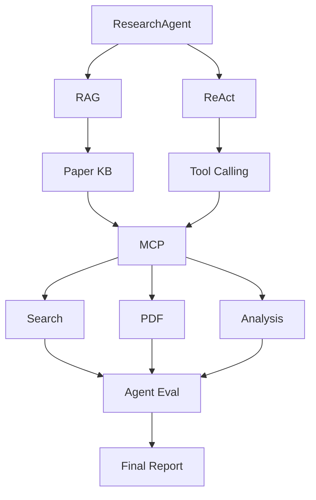
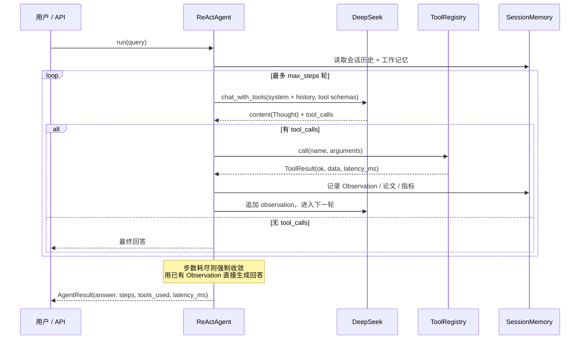

# ResearchAgent 架构设计

> 基于 **ReAct + RAG + MCP** 的科研智能分析 Agent。
> 本文说明系统的分层、数据流与关键设计决策。

---

## 1. 总体架构



对应到代码目录：

| 架构层 | 代码位置 | 职责 |
| --- | --- | --- |
| **Agent** | `research_agent/agent/` | ReAct 循环、Prompt、轨迹记录 |
| **RAG** | `research_agent/rag/` | PDF 解析 → 切分 → Embedding → 索引 → 混合检索 |
| **Tool** | `research_agent/tools/` | 11 个工具的定义与执行，一次定义三处复用 |
| **MCP** | `research_agent/mcp_server/`、`mcp_client/` | 工具标准化暴露与消费 |
| **Memory** | `research_agent/memory/` | 会话历史 + 工作记忆（论文/指标/事实） |
| **API** | `research_agent/api/` | FastAPI 服务层与 Web Demo |
| **Eval** | `research_agent/eval/` | 测试集、四维指标、报告生成 |

---

## 2. 一次任务的生命周期



**关键点：为什么用原生 Function Calling 而不是解析文本？**

ReAct 论文的原始形态是让模型输出 `Thought / Action / Action Input` 文本再正则解析。本项目保留了三段式**轨迹**（`AgentStep` 里照样有 thought / action / observation），但工具调用走 DeepSeek 的 **native tool_calls**：

- 文本解析对格式极度敏感，模型少一个换行就解析失败；native 调用由模型侧保证 JSON 合法。
- `tools` 参数携带 JSON Schema，参数类型由 Schema 约束，而不是靠提示词「请传数组」。
- 失败模式从「解析失败」变成「参数不匹配」，后者可以被工具层捕获并作为 Observation 回传，Agent 能自我纠正。

---

## 3. RAG 检索链路

```mermaid
flowchart LR
    P[PDF / 摘要] --> L[loader.py<br/>pypdf → pypdfium2 兜底]
    L --> C[chunker.py<br/>句子级贪心打包 + 重叠]
    C --> E[embeddings.py<br/>BGE / Hashing]
    E --> V[(vector_store.py<br/>FAISS IndexFlatIP<br/>→ NumPy 兜底)]

    Q[Query] --> DQ[稠密召回]
    Q --> SQ[BM25 稀疏召回]
    V --> DQ
    DQ --> RRF[RRF 融合<br/>Σ 1/(k+rank), k=60]
    SQ --> RRF
    RRF --> RR[轻量 Rerank<br/>query 词重叠 ×1.15]
    RR --> CTX[build_context<br/>带 1 编号引用]
```

**为什么是混合检索而不是纯向量？**

稠密向量擅长语义相近但用词不同的情况（「参数化记忆」≈「parametric memory」），但在**专有名词、模型名、缩写数字**上明显弱于 BM25 —— 而科研场景里恰恰全是这类词（`SQuAD`、`F1`、`BLEU-4`、`DeBERTa-v3`）。两者召回结果用 RRF 融合：

```
score(d) = Σ_r 1 / (k + rank_r(d))     k = 60
```

RRF 只用**排名**不用原始分数，因此不需要对余弦相似度和 BM25 分数做归一化对齐 —— 这是它比加权求和更省事也更稳的原因。

**Rerank 为什么做得这么轻？** 引入 cross-encoder 会带来一次额外的前向传播，延迟与收益在 Top-5 规模下不成正比。当前实现只做 query 词重叠的轻量加权，把精排的收益留给后续迭代（见 §6）。

---

## 4. MCP：工具的一次定义、三处复用

系统的核心抽象是 `Tool` 对象，它同时具备三重身份：

```python
Tool(
    name="search_papers",
    description="...",
    parameters={...},     # JSON Schema
    func=search_papers_impl,
)
```

| 身份 | 用途 | 转换方法 |
| --- | --- | --- |
| 本地函数 | ReAct Agent 直接调用 | `tool.run(**kwargs)` |
| Function Calling Schema | 传给 DeepSeek 的 `tools` 参数 | `tool.to_openai_schema()` |
| MCP Tool | 由 Research MCP Server 暴露 | `tool.to_mcp_schema()` |

MCP Server 启动时遍历注册表动态注册全部 11 个工具：

```python
for tool_obj in registry.tools():
    server.add_tool(tool_obj.func, name=tool_obj.name, description=tool_obj.description)
```

**这样做的意义**：新增一个工具只需要在 `tools/` 下写一个带 `@tool` 装饰器的函数并加进注册表，Agent 侧（Function Calling）与 MCP 侧**同时生效**，不存在「改了一处忘了另一处」的不一致。

MCP 传输层支持两种模式：`stdio`（独立进程，标准 MCP 用法）与 `inprocess`（同进程直连，用于测试和低延迟场景）。

---

## 5. Agent Evaluation：四维指标

评测集是 12 条用例，覆盖 6 个类别：`search`(3) / `rag`(2) / `experiment`(2) / `analysis`(2) / `multi_step`(2) / `robustness`(2)。

| 维度 | 定义 | 实现要点 |
| --- | --- | --- |
| **Task Success Rate** | 答案命中预期关键词比例 ≥ 0.5 记为成功 | `SUCCESS_KEYWORD_THRESHOLD` |
| **Tool Calling Accuracy** | 实际调用工具集合与期望集合的 **F1** | 多调、漏调都扣分，避免「只奖励召回」 |
| **Retrieval Accuracy** | Hit Rate + **MRR** | 见下方说明 |
| **Latency** | mean / p50 / p95 | 单列 p95，均值会掩盖长尾 |

**检索指标为什么要单独探针？** `EvalRunner._retrieval_probe()` 绕过 Agent 直接对知识库检索一次。这样才能区分失败的根因：

- 探针也失败 → **检索没召回**，问题在 RAG（切分/Embedding/Top-K）；
- 探针成功但 Agent 没调检索工具 → **Agent 决策问题**，问题在 Prompt / 工具描述。

两者优化手段完全不同，混在一个指标里就永远定位不到。这是这套评测存在的意义。

---

## 6. 设计取舍与优雅降级

系统在每一个外部依赖上都做了降级路径，保证「任一组件不可用 → 功能减弱但不中断」：

| 依赖 | 首选 | 降级 | 触发条件 |
| --- | --- | --- | --- |
| 向量索引 | FAISS `IndexFlatIP` | NumPy 精确检索 | faiss 未安装 / 平台无 wheel |
| Embedding | BGE (`sentence-transformers`) | Hashing Embedder（md5 分桶 + 二元组） | 模型不可下载 / 无 torch |
| 论文检索 | arXiv API | Semantic Scholar → 离线论文库 | 网络失败 / 429 / WAF 406 |
| PDF 解析 | pypdf | pypdfium2 | 解析异常或文本过少 |
| 指标抽取 | LLM 抽取 | 正则模板抽取 | 未配置 Key / 调用失败 |

降级**不静默**：搜索结果里带 `degraded: True` 与 `sources`，健康检查把状态标成 `degraded`，让调用方明确知道当前拿到的是什么质量的数据。

**已知不足与下一步**：

1. **Rerank 过轻** —— 当前只做词重叠加权，下一步引入 BGE-reranker 做 cross-encoder 精排，用评测集的 Retrieval Accuracy 验证收益；
2. **切分策略固定** —— 目前统一 500/80 字符，未按论文章节结构（Abstract / Method / Experiment）切分，而实验指标恰恰集中在 Experiment 章节；
3. **多步任务的成功率依赖 max_steps** —— 6 步对复杂综述类任务是够的，但缺少「预算感知」的规划（先规划再执行，而不是走一步看一步）。

---

## 7. 目录结构

```
research_agent/
├── agent/          # ReAct 循环与 Prompt
├── rag/            # loader / chunker / embeddings / vector_store / retriever / knowledge_base
├── tools/          # 11 个工具 + 注册表 + 离线论文兜底库
├── mcp_server/     # Research MCP Server（stdio）
├── mcp_client/     # MCP 客户端（stdio / inprocess）
├── memory/         # 会话记忆 + 工作记忆
├── eval/           # 测试集 / 指标 / 执行器
├── api/            # FastAPI 路由、Schema、服务层
├── core/           # DeepSeek 客户端
├── config.py       # 配置单例
└── cli.py          # 命令行入口
```
